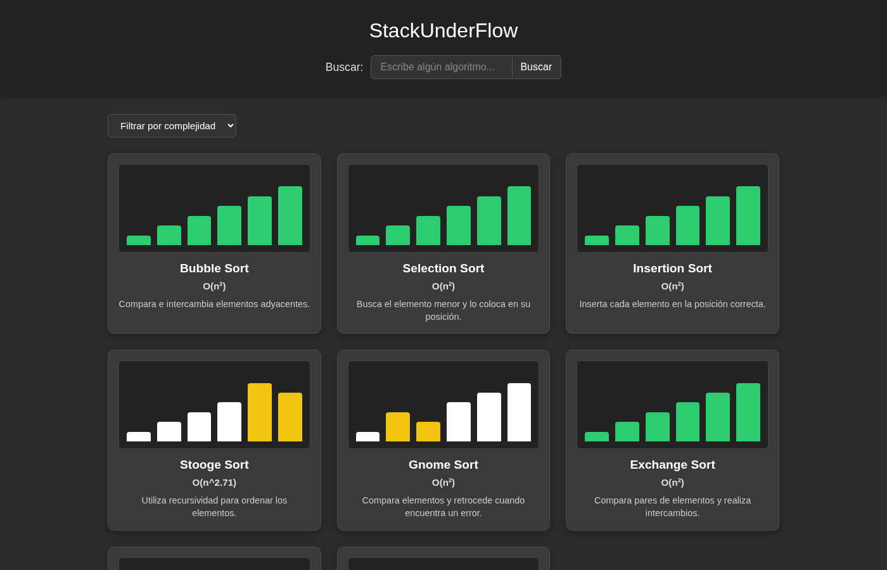
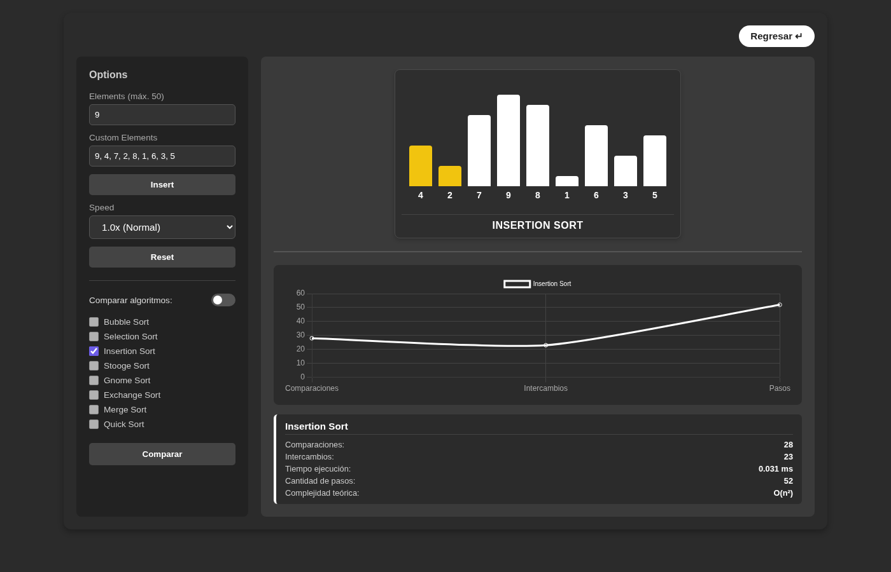
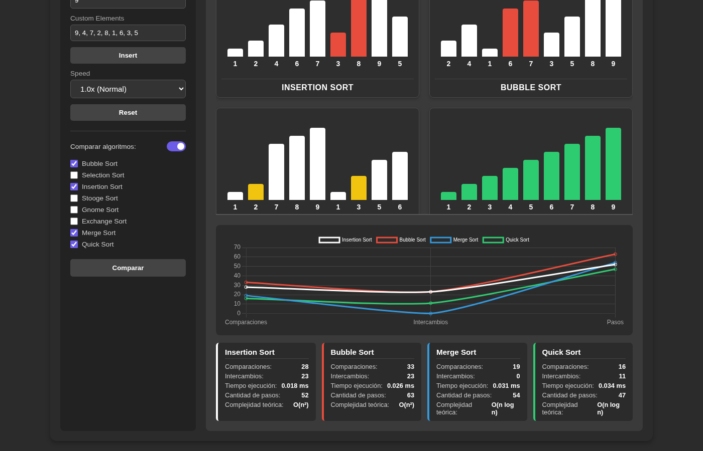
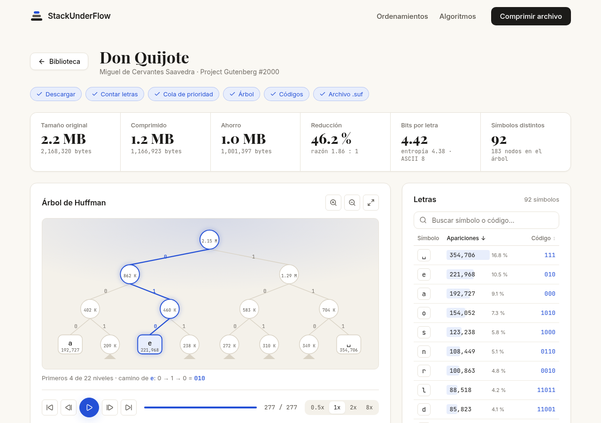
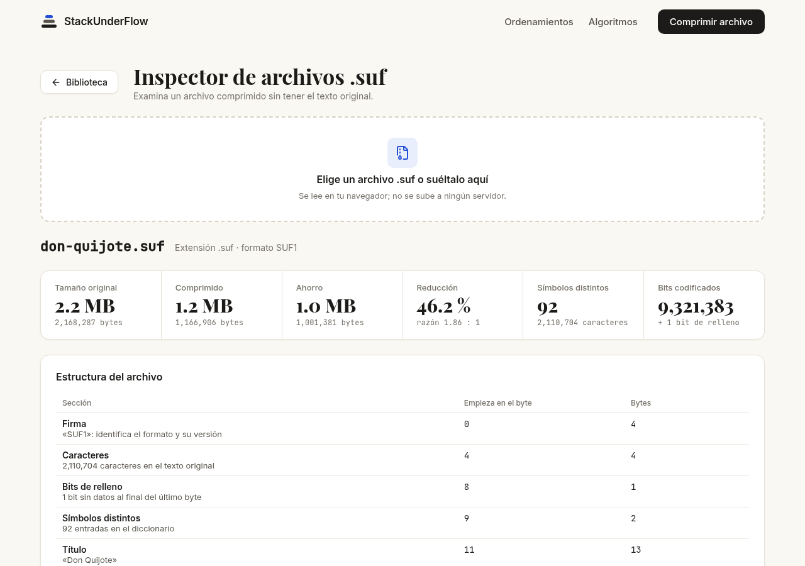

# Stack Underflow — Visualizador web de algoritmos

Aplicación web para visualizar, ejecutar y comparar ocho algoritmos de ordenamiento paso a paso, y para comprimir libros con el **algoritmo de Huffman**, inspeccionar el archivo comprimido (`.suf`) y descomprimirlo (ver [Compresor Huffman](#compresor-huffman)).

Este repositorio contiene el **frontend** (página web). El backend está en [algorithms-visualization-backend](https://github.com/qci-stack-underflow/algorithms-visualization-backend).

| | |
|---|---|
| **Aplicación publicada** | https://stack-underflow-frontend-algviz.vercel.app |
| **API publicada** | https://stack-underflow-backend-algviz.vercel.app |
| **Repositorio frontend** | https://github.com/qci-stack-underflow/algorithms-visualization-frontend |
| **Repositorio backend** | https://github.com/qci-stack-underflow/algorithms-visualization-backend |
| **GitHub Projects** | https://github.com/orgs/qci-stack-underflow/projects/1 |



## Integrantes

| Integrante | Usuario de GitHub | Área |
|---|---|---|
| Arath Josué Campos Gutiérrez | [`arcamp0130`](https://github.com/arcamp0130) | Backend |
| Salvador Ramos García | [`SalvadorRGDev`](https://github.com/SalvadorRGDev) | Backend |
| Edwin Juan Pablo Guzmán Mendoza | [`edguzsv`](https://github.com/edguzsv) | Frontend |
| Alessandra Rodriguez Piz | [`alesspiz`](https://github.com/alesspiz) | Frontend |

Materia: Análisis de Algoritmos — Sección D01 — Ciclo 2026B.

## Descripción

El visualizador permite elegir un algoritmo de ordenamiento, generar o escribir un arreglo de números y ver cómo el algoritmo lo ordena: qué elementos compara, cuáles intercambia y cómo cambia el arreglo hasta quedar ordenado. También permite ejecutar varios algoritmos sobre el mismo arreglo y comparar su comportamiento con métricas (comparaciones, intercambios, pasos, tiempo de ejecución y complejidad teórica).

Los algoritmos se ejecutan en el backend, que registra cada operación como un *paso*. El frontend recibe esos pasos y los anima con un código de colores.

## Objetivo

Ayudar a entender visualmente cómo funciona cada algoritmo de ordenamiento visto en clase y comparar su eficiencia de forma práctica, aplicando el ciclo completo de desarrollo: implementar, visualizar, comparar, documentar, colaborar y publicar.

## Algoritmos implementados

| Algoritmo | Mejor caso | Caso promedio | Peor caso | Idea principal |
|---|---|---|---|---|
| Bubble Sort | O(n) | O(n²) | O(n²) | Intercambia elementos adyacentes; termina antes si una pasada no intercambia nada |
| Selection Sort | O(n²) | O(n²) | O(n²) | Busca el mínimo de lo que falta y lo coloca al frente |
| Insertion Sort | O(n) | O(n²) | O(n²) | Desliza cada elemento hacia la izquierda hasta su lugar en la parte ya ordenada |
| Stooge Sort | O(n^2.71) | O(n^2.71) | O(n^2.71) | Ordena recursivamente los primeros 2/3, los últimos 2/3 y otra vez los primeros 2/3 |
| Gnome Sort | O(n) | O(n²) | O(n²) | Avanza si el par está en orden; si no, intercambia y retrocede |
| Exchange Sort | O(n²) | O(n²) | O(n²) | Compara cada posición con todas las de su derecha |
| Merge Sort | O(n log n) | O(n log n) | O(n log n) | Divide el arreglo, ordena cada mitad y las mezcla |
| Quick Sort | O(n log n) | O(n log n) | O(n²) | Partición de Lomuto: el pivote (último elemento) queda en su lugar final |

El código de cada algoritmo está en [`src/algorithms/definitions/`](https://github.com/qci-stack-underflow/algorithms-visualization-backend/tree/main/src/algorithms/definitions) del backend: un archivo por algoritmo con su ficha (`info`) y su función `sort(t)`.

## Tecnologías utilizadas

| Backend | Frontend |
|---|---|
| Node.js + TypeScript | Vite |
| NestJS 11 (con `@nestjs/config`) | JavaScript (módulos ES, sin framework) |
| Jest y Supertest (pruebas unitarias y e2e) | SASS |
| pnpm | Chart.js (gráfica de métricas) |
| | pnpm |

**Publicación:** Vercel (plan gratuito), con un proyecto independiente para el frontend y otro para el backend.

## Cómo ejecutar el proyecto

Requisitos: Node.js 22 o superior y pnpm 12 (indicado en `packageManager` de `package.json`).

### Frontend (este repositorio)

```bash
git clone https://github.com/qci-stack-underflow/algorithms-visualization-frontend.git
cd algorithms-visualization-frontend
pnpm install
pnpm dev                 # http://localhost:3030
```

Por defecto, el servidor de Vite reenvía las peticiones `/api` al backend local en `http://localhost:3000` (ver la sección siguiente). Para usar en cambio la API publicada, crear un archivo `.env` en la raíz con:

```bash
VITE_API_URL=https://stack-underflow-backend-algviz.vercel.app
```

Producción:

```bash
pnpm build               # genera la carpeta dist/
```

### Backend

Las instrucciones están en el [README del backend](https://github.com/qci-stack-underflow/algorithms-visualization-backend#cómo-ejecutar-el-proyecto). En resumen: `pnpm install` y `pnpm start:dev` (http://localhost:3000).

## Uso de la aplicación

1. En la pantalla de inicio, cada tarjeta muestra una animación corta de su algoritmo. Se puede **buscar** por nombre o **filtrar** por complejidad.
2. Al hacer clic en una tarjeta se abre el **visualizador**.
3. En el panel **Options** se genera un arreglo aleatorio (**Elements**, máximo 50) o se escribe uno propio (**Custom Elements** + **Insert**).
4. Se elige la velocidad (**Speed**).
5. **Comparar** ejecuta la simulación. Las barras cambian de color según la operación:

   | Color | Significado |
   |---|---|
   | Amarillo | Comparación |
   | Rojo | Intercambio |
   | Morado | Escritura (Merge Sort) |
   | Azul | Pivote (Quick Sort) |
   | Verde | Arreglo ordenado |

6. Para comparar, se activa **Comparar algoritmos** y se marcan dos o más: todos se ejecutan sobre el mismo arreglo y se animan a la vez.
7. Las métricas aparecen en las tarjetas y en la gráfica.
8. **Reset** regresa al estado inicial y **Regresar** vuelve al inicio.

### Capturas

**Visualización de un algoritmo** (Insertion Sort comparando dos posiciones):



**Comparación de cuatro algoritmos** sobre el mismo arreglo, con la gráfica y las métricas:



## Compresor Huffman

Pantalla aparte (`huffman.html`, botón **Comprimir archivo**) para la actividad integradora *Huffman Web Compressor*: elegir un libro de Project Gutenberg, ver cómo Huffman cuenta las letras, construye el árbol y asigna los códigos, y obtener un archivo comprimido con formato propio, `.suf` (Stack Under Flow).

**Flujo:** elegir un libro → proceso (cifras, tabla de letras, árbol) → archivo `.suf` (ver los bits o descargarlo) → inspector (examinar, descomprimir y comprobar la integridad).

| Vista | Ruta | Qué muestra |
|---|---|---|
| Biblioteca | `#/` | Catálogo de libros y campo para pegar un enlace de Gutenberg (`/ebooks/2000`, `/cache/epub/2000/…`) |
| Proceso | `#/libro/2000` | Tamaño original y comprimido, bytes ahorrados, reducción y razón de compresión, bits por letra con la entropía, tabla de todos los símbolos (ordenable, con búsqueda y los invisibles visibles: ␣ ↵ ⇥), árbol y pseudocódigo |
| Binario | `#/libro/2000/binario` | Encabezado del `.suf`, cómo se codifica una frase de ejemplo y todos los bits de los datos en una lista virtualizada (solo se dibujan las filas visibles), con los bits de relleno marcados |
| Inspector | `#/inspector` | Se carga solo un `.suf`, sin el texto original, y se ve su estructura byte a byte, el diccionario, el árbol reconstruido y una muestra de los bits. **Descomprimir** recupera el texto en el navegador, comprueba la integridad y permite descargarlo como `.txt` |

**Formato `.suf`.** Firma `SUF1`, total de caracteres, bits de relleno, número de símbolos, título, un diccionario con el símbolo, sus apariciones y su código, y los datos comprimidos. Está documentado byte a byte en `docs/FORMATO-HUFFMAN.md` del backend (en revisión en el PR [backend#51](https://github.com/qci-stack-underflow/algorithms-visualization-backend/pull/51)).

**Integridad.** Al descomprimir, el inspector comprueba, sin el original:
- que los caracteres recuperados sean los que dice el encabezado;
- que las apariciones de cada símbolo coincidan con el diccionario;
- que el tamaño en UTF-8 sea el original;
- que los datos terminen justo al final de un código.

Muestra además el SHA-256 del texto, y si se tiene el `.txt` original, lo compara byte a byte.

**Modo ejemplo.** Mientras el backend no publique las rutas de `/huffman`, el proceso y el binario usan el resultado de ejemplo de Don Quijote (`src/js/huffman/ejemplo-quijote.json`, copia de `docs/ejemplos/huffman-quijote.json` del backend) y avisan con otro libro que es una vista de ejemplo. Cuando el backend tenga las rutas, se usan sus datos sin cambiar nada en el frontend. El inspector y la descompresión no dependen del backend.

**Pruebas:** [`docs/PRUEBAS-HUFFMAN.md`](docs/PRUEBAS-HUFFMAN.md) tiene las pruebas mínimas (texto pequeño, libro de Gutenberg e integridad), con capturas.





## Deployment

| | URL | Proyecto en Vercel |
|---|---|---|
| Frontend | https://stack-underflow-frontend-algviz.vercel.app | `stack-underflow-frontend-algviz` |
| Backend | https://stack-underflow-backend-algviz.vercel.app | `stack-underflow-backend-algviz` |

- Ambos repositorios están conectados a Vercel: cada cambio en `main` se publica automáticamente y cada pull request genera un despliegue de prueba.
- **Backend:** `vercel.json` compila `src/main.ts` con `@vercel/node` y envía todas las rutas (`GET`, `POST` y `OPTIONS` para el preflight de CORS) a la aplicación de Nest.
- **Frontend:** preset de Vite (carpeta de salida `dist`) con la variable `VITE_API_URL` apuntando a la API publicada.
- Todo se publica con el plan gratuito de Vercel.

## Organización del equipo

- **Tablero:** [GitHub Projects](https://github.com/orgs/qci-stack-underflow/projects/1) con las columnas Backlog, Ready, In progress, In review y Done. Cada tarea indica qué se hará, responsable, fecha y criterio de terminado.
- **Ramas:** `main` (versión publicada, solo recibe merges de `dev`), `dev` (integración) y ramas personales `{usuario}/...` que llegan a `dev` mediante pull requests revisados por otro integrante.
- **Sprints:** Sprint 1 (26–30 de septiembre) y Sprint 2 (1–4 de octubre).

### Responsabilidades

| Integrante | Responsabilidades |
|---|---|
| Arath | Configuración del proyecto NestJS, Jest y alias de rutas; organización de módulos; rutas del API, validaciones y manejo de errores HTTP; base del proyecto Vite; configuración y despliegue en Vercel de ambos repositorios |
| Salvador | Formato de entrada y salida de los algoritmos (pasos y métricas); tracer y `runAlgorithm`; servicio de algoritmos; implementación de los 8 algoritmos; pruebas con 3 tamaños de entrada; integración del frontend con el backend (cliente de la API, adaptador de pasos y vista previa animada de las tarjetas); revisión de pull requests |
| Edwin | Motor de animación (reproducción de pasos, velocidad, reinicio y colores de las barras) |
| Alessandra | Diseño de la interfaz: pantalla de inicio, búsqueda y filtro, tarjetas, visualizador, panel de opciones, modo comparar, gráfica y tarjetas de métricas |

### Responsabilidades en el compresor Huffman

El trabajo se dividió en cuatro bloques en el [tablero](https://github.com/orgs/qci-stack-underflow/projects/1), cada uno con sus tareas:

| Bloque | Responsable | Contenido |
|---|---|---|
| A · Algoritmo y formato `.suf` | Arath | Contrato y JSON de ejemplo, frecuencias, min-heap, árbol con sus pasos, códigos y empaquetado de bits, escritura y lectura del `.suf`, métricas y pruebas del algoritmo |
| B · Libros, endpoints y despliegue | Alessandra | Catálogo, cliente de Project Gutenberg, limpieza del texto, copias locales, endpoints de `/huffman`, errores, límites de Vercel, pruebas e2e y documentación del backend |
| C · Datos, biblioteca y vista binaria | Salvador | Rutas y navegación de la pantalla, cliente de la API, carga y errores, biblioteca y enlace de Gutenberg, búsqueda, subida de `.txt`, cifras y tabla de letras, descarga y vista binaria del `.suf`, inspector, descompresión e integridad, documentación del frontend |
| D · Árbol, animación y pseudocódigo | Edwin | Posición y dibujo del árbol, zoom, reproductor de pasos, cola de prioridad, pseudocódigo sincronizado y fases |

## Uso de IA

| Herramienta | Para qué se usó |
|---|---|
| Claude | Apoyo para generar código y pruebas, resolver errores, revisar cambios y automatizar commits y pull requests |

Todo el código generado con apoyo de IA fue revisado y probado por el equipo, que es responsable de él.

## Aprendizajes y conclusiones

**Arath.** Configurar el backend con Nest fue más laborioso de lo que esperaba, sobre todo la parte de Jest y los alias de rutas. Lo que más tiempo me llevó fue el deploy en Vercel: varias veces compilaba sin errores pero no respondía, y tuve que ir probando hasta dar con la configuración correcta. Me quedo con que una cosa es que funcione en local y otra muy distinta que funcione publicado.

**Salvador.** No tenía experiencia con Git ni con páginas web, y al principio no entendía bien cómo se conectaban el frontend y el backend. Diseñar el formato de los pasos me ayudó a ver cada algoritmo como una serie de operaciones pequeñas que se pueden contar y animar. También aprendí a trabajar con ramas y pull requests, y a revisar el código de mis compañeros antes de unirlo.

**Edwin.** El motor de animación lo empecé en React, pero tuve que pasarlo a JavaScript normal para que coincidiera con lo que ya tenía el equipo. Fue frustrante rehacerlo, aunque terminó siendo más sencillo de lo que pensaba. Entendí mejor cómo funciona `setInterval` y cómo cambiar el aspecto de una barra según lo que esté haciendo el algoritmo.

**Alessandra.** Me tocó la parte visual, así que estuve trabajando mucho con HTML, SASS y la gráfica de Chart.js. Hacer que las pantallas se vieran bien en computadora y en celular costó más de lo que imaginaba. Algo que haría diferente es subir mis avances antes, porque al integrarlo todo al final hubo cosas repetidas con lo de Edwin.

**Conclusión del equipo.** El proyecto nos sirvió para ver los algoritmos de ordenamiento de otra forma: no solo como código, sino como pasos que se pueden observar y comparar. Notamos que la diferencia entre O(n²) y O(n log n) se vuelve muy clara al ver cuántas comparaciones hace cada uno con el mismo arreglo. La organización fue lo más difícil; varias partes se unieron tarde y eso complicó la integración, pero al final logramos tener todo funcionando y publicado.

## Documentación técnica del frontend

| Archivo | Contenido |
|---|---|
| `src/index.html` | Estructura de la pantalla de inicio y del visualizador |
| `src/sass/` | Estilos (SASS) |
| `src/js/script.js` | Lógica de la interfaz: tarjetas, búsqueda y filtro, panel de opciones, modo comparar, gráfica y tarjetas de métricas, vista previa de las tarjetas |
| `src/js/api.js` | Cliente de la API: `POST /algorithms/:id/run` (un algoritmo) y `POST /algorithms/compare` (dos o más) |
| `src/js/pasos.js` | Adaptador: convierte los pasos del backend (`compare`, `swap`, `write`, `pivot`, `sorted`) al formato `{ tipo, indices, arrayState }` del motor, reconstruyendo el arreglo a partir de `input` |
| `src/js/animador.js` | `MotorAnimacion`: reproduce los pasos con `setInterval`, permite cambiar la velocidad y reiniciar, y colorea las barras |
| `vite.config.js` | Configuración de Vite y proxy `/api` → backend local para desarrollo |

### Flujo de una ejecución

1. El usuario presiona **Comparar**.
2. `api.js` envía el arreglo al backend (`/run` o `/compare`).
3. El backend devuelve los pasos y las métricas de cada algoritmo.
4. `pasos.js` convierte los pasos al formato del motor.
5. `MotorAnimacion` anima las barras de cada algoritmo a la vez.
6. Las métricas se muestran en las tarjetas y en la gráfica de Chart.js.

La dirección del backend se toma de `VITE_API_URL`; si no está definida, se usa `/api` (el proxy de desarrollo).

### Pantalla de Huffman

| Archivo | Contenido |
|---|---|
| `src/huffman.html` | Las cuatro vistas: biblioteca, proceso, binario e inspector |
| `src/js/huffman.js` | Punto de entrada: inicia la tabla, la navegación, la biblioteca, las descargas, el binario y el inspector |
| `src/js/huffman/rutas.js` | Lee y arma las rutas del hash (`#/`, `#/libro/N`, `#/libro/N/binario`, `#/inspector`) |
| `src/js/huffman/navegacion.js` | Muestra la vista de la ruta, cuida el scroll, el foco y el historial, y pide los datos del libro |
| `src/js/huffman/datos.js` | `cargarLibro`: pide el resultado (y el `.suf` en el binario) mostrando la carga y los errores; modo ejemplo si el backend no tiene `/huffman` |
| `src/js/huffman/carga.js` | Fases de la carga y un mensaje para cada error del backend (400, 404, 413, 504, sin conexión) |
| `src/js/huffman/biblioteca.js` | Tarjetas desde `GET /huffman/books` y lectura del enlace de Gutenberg |
| `src/js/huffman/proceso.js`, `tabla.js` | Cifras de la compresión y tabla de letras (orden, búsqueda y evento `simbolo-seleccionado` para el árbol) |
| `src/js/huffman/descarga.js` | Descarga del `.suf` con un `Blob` |
| `src/js/huffman/suf.js` | Lectura del `.suf` (`leerSuf`), tamaño original, árbol reconstruido, `descomprimir` y comprobaciones de integridad |
| `src/js/huffman/binario.js` | Vista binaria con la lista virtualizada de bits |
| `src/js/huffman/inspector.js` | Inspector: cargar, examinar, descomprimir, descargar y comparar |
| `src/js/huffman/formato.js` | Números, tamaños (KB/MB), ahorro y símbolos invisibles |
| `src/js/api.js` | También `obtenerLibros`, `obtenerHuffman` y `descargarSuf`, con caché por libro |

Eventos para el árbol (bloque D): `huffman-resultado` (`{ libro, resultado, ejemplo }`, cada vez que se llena el proceso o el binario), `simbolo-seleccionado` (`{ symbol, code, nodeId }` o `null`) y `suf-inspeccionado` (`{ nombre, encabezado, nodes, rootId }` desde el inspector).

## Limitaciones conocidas

- **Compresión:** el backend todavía no publica las rutas de `/huffman`. La pantalla de Huffman funciona en modo ejemplo (Don Quijote) y aún no comprime textos nuevos; la descarga del `.suf` desde un libro espera a esos endpoints.
- **Búsqueda en Gutenberg y subida de `.txt`:** pendientes (C10 y C11); dependen de las decisiones de [backend#52](https://github.com/qci-stack-underflow/algorithms-visualization-backend/issues/52) y [backend#53](https://github.com/qci-stack-underflow/algorithms-visualization-backend/issues/53).
- **Árbol:** el dibujo animado del árbol (bloque D) está en desarrollo. El inspector reconstruye el árbol y lo resume, pero aún no lo dibuja.
- **Despliegues de prueba de Vercel:** no tienen `VITE_API_URL`, así que los ordenamientos solo funcionan en producción y en local.
