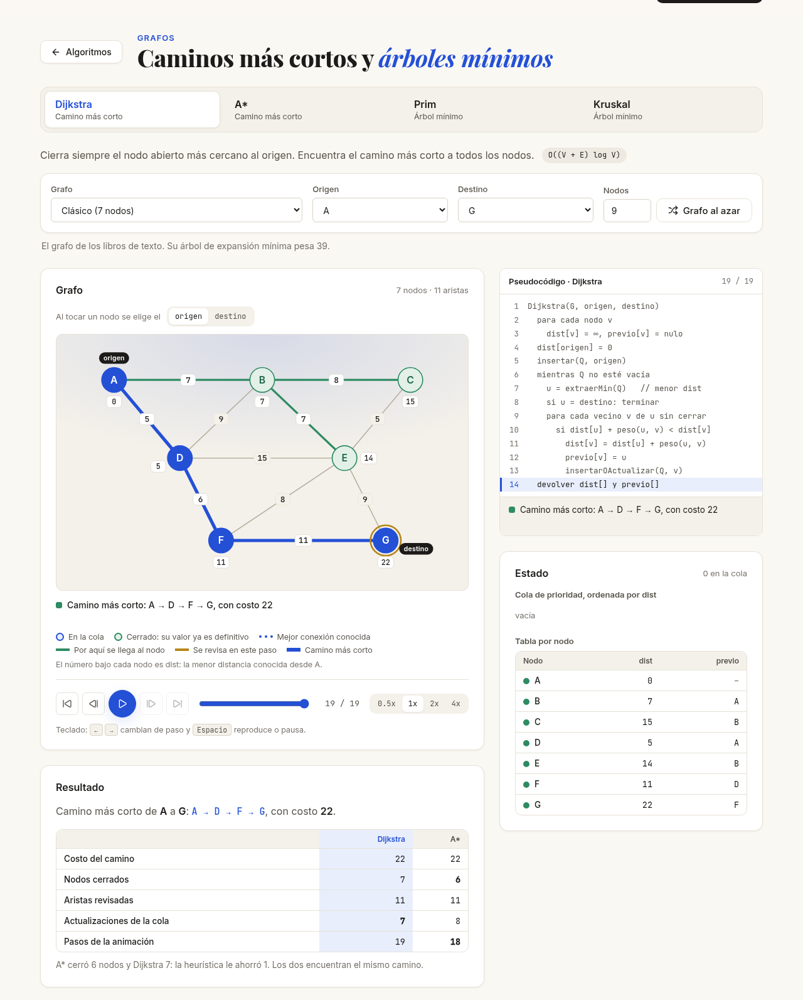
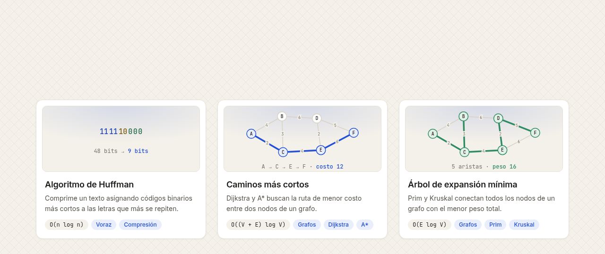
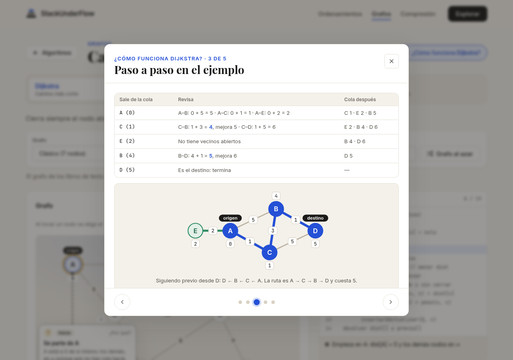
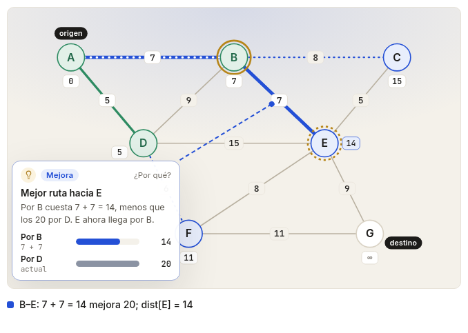
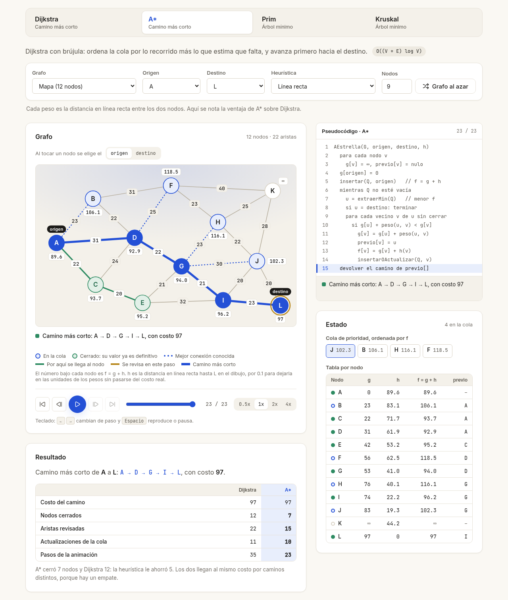
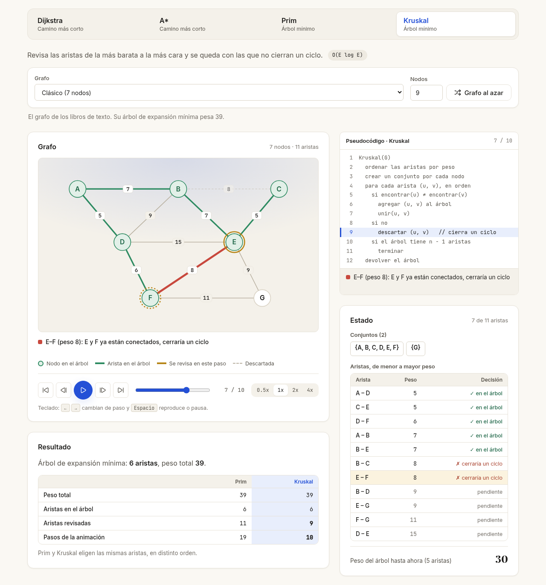
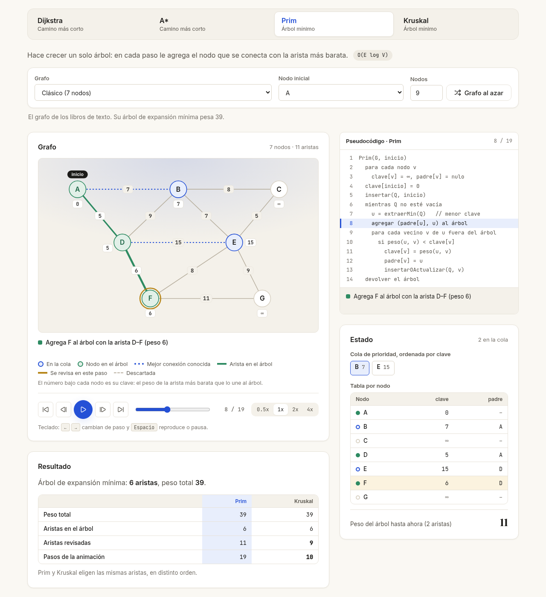

# Algoritmos de grafos (frontend)

Pantalla aparte, `grafos.html`, para ver paso a paso cuatro algoritmos sobre un grafo ponderado no dirigido:

| Algoritmo | Problema | Idea | Complejidad |
|---|---|---|---|
| **Dijkstra** | Camino más corto desde un origen | Cierra siempre el nodo abierto con la menor distancia conocida | O((V + E) log V) |
| **A\*** | Camino más corto entre dos nodos | Dijkstra con otra prioridad: lo recorrido más lo que se estima que falta | O((V + E) log V) |
| **Prim** | Árbol de expansión mínima | Hace crecer un solo árbol con la arista más barata que sale de él | O(E log V) |
| **Kruskal** | Árbol de expansión mínima | Recorre las aristas de menor a mayor y descarta las que cierran un ciclo | O(E log E) |

Todo se calcula en el navegador. La pantalla no usa el backend y no comparte código con la de Huffman ni con el visualizador de ordenamientos, así que no depende de ellos.



## Uso

1. Se entra desde el inicio, con las tarjetas **Caminos más cortos** y **Árbol de expansión mínima** del bloque «Más allá de ordenar», o directo en `grafos.html`.
   

2. Las pestañas eligen el algoritmo. Cada una es también una dirección (`#/dijkstra`, `#/a-estrella`, `#/prim`, `#/kruskal`). El botón **¿Cómo funciona…?**, a la derecha del título, abre la guía del algoritmo actual (ver abajo).
3. En **Grafo** se elige uno de los ejemplos o se genera uno al azar (de 4 a 14 nodos).
4. **Origen** y **Destino** se eligen en las listas o tocando un nodo del dibujo. En Dijkstra el destino puede ser «Todos los nodos»; A\* siempre necesita uno; Prim solo pide el nodo inicial y Kruskal ninguno.
5. El reproductor avanza, retrocede o reproduce los pasos (teclas `←`, `→` y `Espacio`). En cada paso se ve:
   - el **dibujo**, con el estado de cada nodo y arista y el valor de cada nodo;
   - el **pseudocódigo**, con la línea que se ejecuta y una frase que dice qué pasó;
   - el **estado**: la cola de prioridad y la tabla por nodo o, en Kruskal, los conjuntos y las aristas ordenadas;
   - en Dijkstra, A\* y Prim, un **globo «¿Por qué?»** sobre el dibujo (ver abajo).
6. **Resultado** dice qué se encontró y compara el algoritmo con el otro que resuelve el mismo problema.
7. **Escribir o editar el grafo** permite cambiar pesos y aristas o escribir un grafo propio, una arista por línea (`A B 7`).

La dirección guarda la selección, así que se puede compartir o recargar:

```
grafos.html#/a-estrella?grafo=mapa&origen=A&destino=L&h=manhattan
grafos.html#/prim?grafo=azar&semilla=7&nodos=14&origen=A
```

### Colores del dibujo

| En el dibujo | Significado |
|---|---|
| Nodo blanco | Todavía no se llega a él |
| Nodo azul claro | Está en la cola de prioridad |
| Nodo verde | Cerrado: su valor ya es definitivo (o ya es parte del árbol) |
| Arista azul punteada | La mejor conexión conocida hacia un nodo de la cola |
| Arista verde | Por ahí se llega al nodo (o es parte del árbol) |
| Arista ámbar, azul, verde o roja gruesa | La que se revisa en este paso: no mejora, mejora, se acepta o se rechaza |
| Arista azul gruesa y nodos azules | El camino más corto, al terminar |
| Arista gris punteada | Descartada: no es parte del árbol |

Ningún estado depende solo del color: las aristas cambian también de grosor y de trazo, y la tabla de estado repite lo mismo con texto.

### La guía «¿Cómo funciona?»

El botón de la barra superior abre, encima de la pantalla, una guía de cinco páginas del algoritmo de la pestaña actual: la idea, lo que lleva en memoria, el ejemplo paso a paso, por qué funciona y su costo y usos. Las cuatro guías usan el mismo grafo chico de cinco nodos, así que se pueden comparar: Dijkstra y A\* llegan a la misma ruta (A\* sin cerrar E), y Prim y Kruskal al mismo árbol de peso 7.



- Las flechas de los lados y las teclas `←` `→` cambian de página; abajo hay un círculo por página y el de la actual es más grande. Un clic en un círculo lleva a esa página.
- `Escape`, la ✕ o un clic fuera del cuadro la cierran. Al abrirla se pausa la reproducción, y mientras está abierta las flechas no mueven el reproductor de atrás.
- Al volver a abrir la guía del mismo algoritmo sigue en la página donde se quedó.
- El cuadro tiene alto fijo: si una página no cabe, se desplaza su contenido y las flechas no se mueven.

### El globo «¿Por qué?»

En Dijkstra, A\* y Prim, cada paso trae un globo que explica **por qué** el algoritmo hace lo que hace, con los números de ese paso:



- **Al sacar un nodo de la cola:** por qué es ese y no otro. Las barras comparan las prioridades de la cola (distancia, f = g + h o clave) y el elegido es la más corta. En Dijkstra dice además por qué su distancia ya no puede mejorar.
- **Al revisar una arista:** si la ruta nueva mejora a la que se tenía o no, con la suma (`7 + 7 = 14`) y una barra contra la ruta actual.
- **Al terminar:** la ruta o el árbol que salió y cuánto cuesta.

La ruta de la que habla se marca en el dibujo con puntos blancos que avanzan desde el origen: sobre azul si mejora, sobre rojo si no conviene y sobre verde si ya quedó fija. En Prim solo se marca la arista, porque ahí no importa lo recorrido.

El globo se acomoda solo: busca el hueco del dibujo que tape menos, sobre todo la ruta y los nodos de los que habla, y una línea punteada lo une con lo que explica. Con el puntero encima se vuelve casi transparente para ver lo que tapa. Si el dibujo es angosto (teléfonos), va debajo del dibujo. El botón **Explicar pasos** lo apaga y la página lo recuerda. Kruskal no lo tiene: su porqué ya está en cada paso (une dos conjuntos o cerraría un ciclo).

## Grafos de ejemplo

| Grafo | Nodos | Aristas | Para qué sirve |
|---|---|---|---|
| Clásico | 7 | 11 | El de los libros de texto: su árbol de expansión mínima pesa 39 |
| Mapa | 12 | 22 | Cada peso es el largo de la arista; aquí A\* cierra menos nodos que Dijkstra |
| Cuadrícula | 16 | 24 | Calles en cuadrícula con distinto costo, para la heurística Manhattan |
| Dos islas | 7 | 8 | No es conexo: no hay camino de A a G y el árbol mínimo es un bosque |

El **grafo al azar** reparte los nodos en una cuadrícula con algo de desorden, une cada uno con sus vecinos más cercanos sin cruzar aristas y pone como peso el largo de la arista alargado hasta un 50 %. Siempre es conexo, y con la misma semilla sale el mismo grafo.

## La heurística de A\*

A\* ordena la cola por `f(v) = g(v) + h(v)`: lo recorrido desde el origen más una estimación de lo que falta. La estimación sale de la posición de los nodos en el dibujo, pero el dibujo y los pesos no están en las mismas unidades, así que se convierte con una escala:

```
escala = el menor (peso / distancia en el dibujo) entre todas las aristas
h(v)   = distancia en el dibujo de v al destino × escala
```

Con esa escala ninguna arista cuesta menos de lo que mide en el dibujo. Junto con la desigualdad del triángulo, eso da `h(u) ≤ peso(u, v) + h(v)` para toda arista: la heurística es **consistente**, y por lo tanto nunca estima de más. Por eso A\* encuentra siempre el camino más corto y puede cerrar cada nodo una sola vez, igual que Dijkstra.

Hay tres opciones: **línea recta**, **Manhattan** y **sin heurística** (`h = 0`, con la que A\* hace exactamente lo mismo que Dijkstra). Si los pesos no tienen relación con el dibujo, la escala sale pequeña y A\* ahorra poco, pero el resultado sigue siendo correcto.



## Resultados con los ejemplos

Dijkstra y A\* van del origen al destino que trae cada ejemplo; A\* usa la línea recta.

| Grafo | Costo | Nodos cerrados: Dijkstra | Nodos cerrados: A\* | Pasos: Dijkstra | Pasos: A\* |
|---|---|---|---|---|---|
| Clásico (A → G) | 22 | 7 | 6 | 19 | 18 |
| Mapa (A → L) | 97 | 12 | 7 | 35 | 23 |
| Cuadrícula (A → P) | 21 | 16 | 13 | 41 | 35 |
| Dos islas (A → G) | sin camino | 4 | 4 | 10 | 10 |

| Grafo | Peso del árbol | Aristas revisadas: Prim | Aristas revisadas: Kruskal | Descartadas por Kruskal |
|---|---|---|---|---|
| Clásico | 39 | 11 | 9 | 3 |
| Mapa | 238 | 22 | 16 | 5 |
| Cuadrícula | 52 | 24 | 16 | 1 |
| Dos islas | Prim 12 (solo la parte de A), Kruskal 21 (bosque de 2 árboles) | 5 | 8 | 3 |

## Comprobación a mano: el grafo clásico

Aristas: A–B 7, A–D 5, B–C 8, B–D 9, B–E 7, C–E 5, D–E 15, D–F 6, E–F 8, E–G 9, F–G 11.

**Kruskal.** Las aristas con el mismo peso conservan el orden de la lista.

| # | Arista | Peso | Decisión | Conjuntos después |
|---|---|---|---|---|
| 1 | A–D | 5 | entra | {A, D} {B} {C} {E} {F} {G} |
| 2 | C–E | 5 | entra | {A, D} {B} {C, E} {F} {G} |
| 3 | D–F | 6 | entra | {A, D, F} {B} {C, E} {G} |
| 4 | A–B | 7 | entra | {A, B, D, F} {C, E} {G} |
| 5 | B–E | 7 | entra | {A, B, C, D, E, F} {G} |
| 6 | B–C | 8 | cerraría un ciclo | sin cambio |
| 7 | E–F | 8 | cerraría un ciclo | sin cambio |
| 8 | B–D | 9 | cerraría un ciclo | sin cambio |
| 9 | E–G | 9 | entra | {A, B, C, D, E, F, G} |

Con 6 aristas (n − 1) termina sin revisar F–G ni D–E. Peso: 5 + 5 + 6 + 7 + 7 + 9 = **39**.



**Prim desde A.** Entran, en orden: D por A–D (5), F por D–F (6), B por A–B (7), E por B–E (7), C por C–E (5) y G por E–G (9). Son las mismas seis aristas en otro orden, y el mismo peso, **39**.



**Dijkstra desde A.** Los nodos se cierran de menor a mayor distancia: A (0), D (5), B (7), F (11), E (14), C (15) y G (22). El camino a G es A → D → F → G: 5 + 6 + 11 = **22**.

## Cómo está hecho

Los algoritmos son funciones puras, sin nada del navegador: reciben un grafo y devuelven `{ pasos, resultado, metricas }`. Por eso corren igual en Node, que es donde se prueban, y se podrían mover a un módulo del backend casi sin cambios.

| Archivo | Responsabilidad |
|---|---|
| `src/grafos.html`, `src/sass/_grafos-screen.scss` | Estructura y estilos de la pantalla (clases con prefijo `gr-`) |
| `src/js/grafos.js` | Punto de entrada |
| `src/js/grafos/grafo.js` | Modelo del grafo: valida los datos y arma la lista de vecinos |
| `src/js/grafos/monticulo.js` | Cola de prioridad (montículo binario) que permite cambiar la prioridad de un nodo |
| `src/js/grafos/conjuntos.js` | Conjuntos disjuntos (union-find) con unión por tamaño y compresión de caminos |
| `src/js/grafos/dijkstra.js`, `a-estrella.js`, `prim.js`, `kruskal.js` | Un algoritmo por archivo, con su pseudocódigo |
| `src/js/grafos/heuristica.js` | Las tres heurísticas de A\* y su escala |
| `src/js/grafos/registro.js` | Registro de pasos y estados de nodos y aristas |
| `src/js/grafos/algoritmos.js` | Catálogo: nombre, complejidad, qué datos pide cada uno y cómo ejecutarlo |
| `src/js/grafos/descripciones.js` | La frase de cada paso |
| `src/js/grafos/explicaciones.js` | El porqué de cada paso para el globo: textos, barras y ruta propuesta |
| `src/js/grafos/globo.js` | Globo sobre el dibujo: lo llena y busca dónde colocarlo |
| `src/js/grafos/guia.js` | Contenido de la guía de cada algoritmo y su grafo de ejemplo (solo datos) |
| `src/js/grafos/guia-dialogo.js` | Cuadro de la guía: dibuja las páginas, los círculos y las flechas |
| `src/js/grafos/ejemplos.js`, `generador.js`, `texto.js` | Grafos de ejemplo, al azar y escritos a mano |
| `src/js/grafos/ruta.js` | Lee y arma la dirección (`#/algoritmo?grafo=…`) |
| `src/js/grafos/lienzo.js` | Dibujo en SVG; coloca los pesos y las etiquetas donde no se enciman |
| `src/js/grafos/reproductor.js` | Botones, barra de progreso, velocidad y teclado |
| `src/js/grafos/tablas.js`, `resultado.js` | Panel de estado y panel de resultado |
| `src/js/grafos/pantalla.js` | Une todo: controles, dibujo, reproductor y tablas |
| `src/js/vista-grafos.js`, `src/sass/_vista-grafos.scss` | Vistas previas de las dos tarjetas del inicio |

Archivos compartidos que se tocaron: `vite.config.js` (la página nueva), `package.json` (el script `test`), `src/js/script.js` (las dos tarjetas), `src/sass/style.scss` (los estilos de sus vistas previas) y `src/index.html` (un párrafo y una cifra).

### Formato de los pasos

Cada paso es una foto completa, así el reproductor puede saltar a cualquiera sin recalcular:

```js
{
  tipo: "relajar",        // inicio, extraer, relajar, mantener, aceptar, rechazar o fin
  linea: 10,              // línea del pseudocódigo, desde 0
  nodo: "D",              // nodo que se procesa
  vecino: "G",            // vecino que se revisa
  arista: "D-G",          // arista que se revisa
  nodos: { A: "cerrado", B: "frontera", E: "nuevo" /* … */ },
  aristas: { "A-B": "candidata", "A-D": "arbol", "C-E": "normal" /* … */ },
  // más las tablas del algoritmo: dist, previo y cola (Dijkstra); g, h y f (A*);
  // clave, padre y arbol (Prim); orden, conjuntos y arbol (Kruskal)
}
```

Los pasos solo llevan datos que caben en un JSON (una distancia infinita se guarda como `null`).

### Empates

Para que cada ejecución dé los mismos pasos, los empates se resuelven siempre igual: en la cola gana el nodo que va antes en la lista (en A\*, primero el que está más cerca del destino), los vecinos se recorren en el orden de la lista y Kruskal conserva el orden original de las aristas con el mismo peso.

## Pruebas

```bash
pnpm test      # node --test, sin dependencias nuevas
```

Son 133 pruebas en `pruebas/grafos/`. Las más importantes comparan cada algoritmo con una solución calculada de otra forma, sobre grafos al azar que incluyen pesos repetidos, pesos en cero y grafos no conexos:

| Qué se comprueba | Contra qué | Casos |
|---|---|---|
| Distancias de Dijkstra, desde cada nodo | Floyd–Warshall | 300 grafos |
| Costo y camino de Dijkstra con destino | Floyd–Warshall | 300 grafos |
| Costo y camino de A\*, con las tres heurísticas | Floyd–Warshall | 600 grafos |
| Que las heurísticas sean consistentes y nunca estimen de más | La definición, arista por arista | 300 grafos |
| Peso del árbol de Prim (desde cada nodo) y de Kruskal | Fuerza bruta sobre todos los subconjuntos de aristas | 400 grafos |
| Prim y Kruskal entre sí | Mismo peso total | 200 grafos generados |
| Montículo y conjuntos disjuntos | Versiones simples con una lista | 2 000 y 500 operaciones |

También se revisa que cada paso sea una foto completa y coherente con la anterior (un nodo cerrado no se vuelve a abrir, la cola tiene justo los nodos de la frontera y en orden, cada paso apunta a una línea que existe y tiene su frase), los grafos de ejemplo, el generador (500 semillas: siempre conexo y legible), el lector de grafos escritos a mano y la dirección de la página.

Para el globo se revisa, en todos los pasos de Dijkstra, A\* y Prim sobre unos 90 grafos, que apunte a un nodo o a una arista que existen, que no le falte texto, que sus barras digan lo mismo que el paso (la ruta nueva es más barata cuando mejora y el nodo que sale es el menor de la cola) y que la ruta que marca sea un camino unido desde el origen hasta lo que se revisa.

Para la guía se ejecutan los cuatro algoritmos sobre su grafo de ejemplo y se comparan con lo que dicen las tablas: el orden en que salen los nodos, la cola después de cada uno, la ruta, el costo, el árbol y su peso. Si alguien cambia el ejemplo o un algoritmo, la prueba avisa que la guía quedó desactualizada.

Como control, se introdujeron siete errores a propósito en los algoritmos y las estructuras (por ejemplo, ordenar las aristas al revés o comparar con la distancia acumulada en Prim), y las pruebas detectaron los siete.

**En el navegador.** Con Chromium se recorrió la pantalla como lo haría una persona: 81 comprobaciones del reproductor, el teclado, las pestañas, la elección de origen y destino, los grafos de ejemplo, al azar y escritos a mano, las heurísticas y las direcciones. Pasan todas, sin errores en la consola, y no hay desplazamiento horizontal a 390, 768 ni 1040 px de ancho. Para el globo hay otras 388: en cada paso de ocho recorridos queda visible y dentro del dibujo, marca la ruta correcta y en el sentido correcto, el botón lo apaga y se recuerda al recargar, Kruskal no lo muestra, deja pasar los clics a los nodos y a 390 px va debajo del dibujo. Colocarlo tarda menos de 25 ms por paso, incluso con 16 nodos. La guía tiene otras 105: en los cuatro algoritmos recorre todas las páginas con las flechas, los círculos y el teclado, revisa que el círculo actual sea el más grande, que el cuadro no cambie de alto, que el foco no se salga, que se cierre con Escape y con un clic afuera, y que quepa en un teléfono de 390 px.

## Limitaciones

- Los grafos son no dirigidos y los pesos no pueden ser negativos (Dijkstra y A\* no funcionan con pesos negativos).
- Un grafo escrito a mano admite hasta 16 nodos y 40 aristas, y no se guarda en la dirección de la página.
- Los nodos no se pueden arrastrar: un nodo nuevo en un grafo escrito a mano reacomoda todo en un óvalo.
- En pantallas angostas el dibujo conserva un tamaño legible y se desplaza de lado dentro de su marco.
