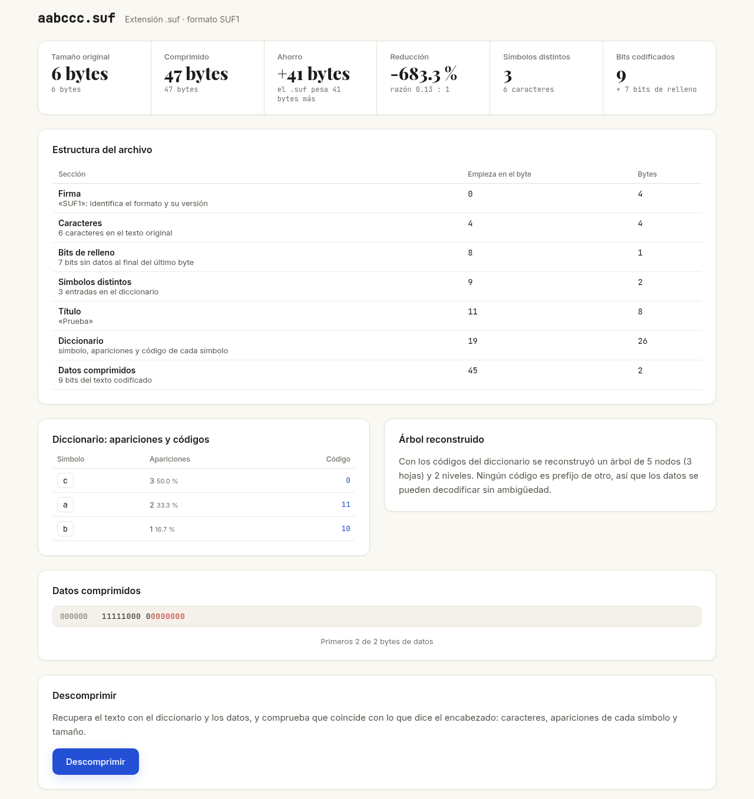
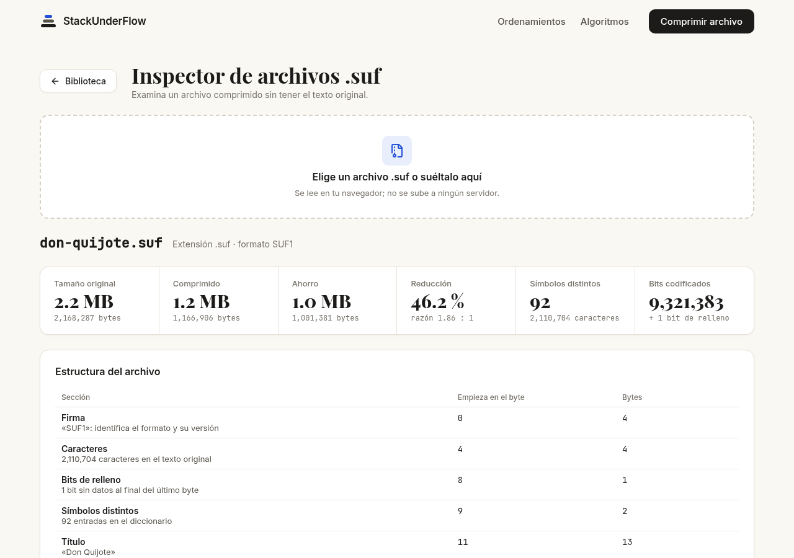
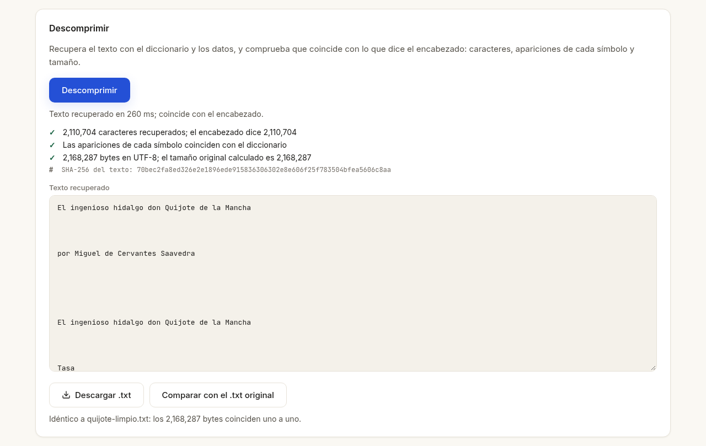

# Pruebas del compresor Huffman (frontend)

Evidencias de las pruebas mínimas de la sección 12 de los requerimientos y de la comprobación de integridad de la sección 8, en la parte que hace el frontend: leer un archivo `.suf`, inspeccionarlo, descomprimirlo y comprobar que el texto recuperado es idéntico al original.

> **Estado al 8 de noviembre de 2026.** El backend todavía no publica los endpoints de `/huffman`, así que la aplicación aún no comprime textos. Los archivos `.suf` de estas pruebas se generaron con un script de prueba que sigue el formato SUF1 de `docs/FORMATO-HUFFMAN.md` del backend, con la misma regla de desempate. Cuando el compresor esté publicado, las pruebas se repiten con archivos generados por la aplicación (ver [Pendiente](#pendiente)).

Todas las pruebas se hicieron en la aplicación publicada (https://stack-underflow-frontend-algviz.vercel.app/huffman.html#/inspector), con Chromium.

## 1. Texto pequeño: `aabccc`

Archivos: [`pruebas/aabccc.txt`](pruebas/aabccc.txt) (6 bytes) y [`pruebas/aabccc.suf`](pruebas/aabccc.suf) (47 bytes).

**Frecuencias.** `a` aparece 2 veces, `b` 1 y `c` 3. En orden de primera aparición, las hojas son `a` (id 0), `b` (id 1) y `c` (id 2).

**Construcción del árbol a mano.** La cola saca primero el menor peso y, si empatan, el menor id. El primero que sale va a la izquierda (bit 0) y el segundo a la derecha (bit 1).

| Paso | Cola antes (peso, id) | Sale `x` (izq., 0) | Sale `y` (der., 1) | Se inserta |
|---|---|---|---|---|
| 1 | b(1, 1) · a(2, 0) · c(3, 2) | b | a | nodo 3, peso 3 |
| 2 | c(3, 2) · nodo 3 (3, 3) | c (empate de peso: gana el id menor) | nodo 3 | raíz 4, peso 6 |

**Códigos.** `c` = `0`, `b` = `10`, `a` = `11`. El texto queda `11 11 10 0 0 0`: 9 bits en lugar de 48, que ocupan 2 bytes con 7 bits de relleno.

**Tamaño del archivo.** El encabezado mide 45 bytes:
- firma (4), caracteres (4), relleno (1), símbolos (2), largo del título (2) y título "Prueba" (6), que suman 19;
- más el diccionario: `a` y `b` miden 1 + 1 + 4 + 1 + 2 = 9 bytes cada uno, y `c` mide 8, que suman 26.

Con los 2 bytes de datos, el archivo mide **47 bytes**: más que el original, porque en un texto tan corto pesa más el diccionario que lo que se ahorra. El inspector lo dice ("el .suf pesa 41 bytes más").

**Resultado en el inspector.** Coincide con el cálculo a mano: 3 símbolos, códigos `c=0`, `a=11` y `b=10`, árbol de 5 nodos y 2 niveles, y una fila de datos `11111000 0` con los 7 bits de relleno marcados. Al descomprimir se recupera `aabccc`, y al compararlo con `aabccc.txt` sale idéntico: 6 de 6 bytes.

## 2. Libro de Project Gutenberg: Don Quijote (#2000)

Texto: `https://www.gutenberg.org/cache/epub/2000/pg2000.txt`, sin la licencia de Gutenberg (entre `*** START OF` y `*** END OF`), sin BOM y con `\n` en lugar de `\r\n`, como lo limpia el backend.

| Dato | Valor |
|---|---|
| Texto original | 2,168,287 bytes, 2,110,704 caracteres |
| Símbolos distintos | 92 |
| Archivo `.suf` | 1,166,906 bytes: encabezado 1,733 y datos 1,165,173 |
| Bits codificados | 9,321,383, más 1 bit de relleno |
| Ahorro | 1,001,381 bytes, **46.2 %** de reducción, razón 1.86 : 1 |
| Árbol reconstruido | 183 nodos (92 hojas) y 21 niveles |
| Descompresión en el navegador | entre 180 y 260 ms |

El inspector calcula el tamaño original solo con el diccionario (frecuencia × bytes de cada símbolo en UTF-8) y da 2,168,287 bytes, el tamaño exacto del texto. Los primeros 128 bytes de datos que muestra, decodificados con el diccionario, dicen "El ingenioso hidalgo don Quijote…".

## 3. Integridad

Al descomprimir, el inspector comprueba tres cosas **sin necesitar el original**:
1. **Caracteres:** cuántos se recuperaron, contra lo que dice el encabezado.
2. **Apariciones:** se vuelven a contar en el texto y se comparan con el diccionario.
3. **Tamaño:** los bytes del texto en UTF-8, contra el tamaño original calculado.

Además, la descompresión falla si un bit no lleva a ningún nodo o si los datos terminan a la mitad de un código. También se muestra el **SHA-256** del texto recuperado. Si se tiene el `.txt` original, se compara **byte a byte**.

| Caso | Resultado |
|---|---|
| `don-quijote.suf` | Las 3 comprobaciones bien. SHA-256 `70bec2fa8ed326e2e1896ede915836306302e8e606f25f783504bfea5606c8aa`, igual al calculado con `sha256sum` del texto original |
| Comparado con el texto original | "Idéntico: los 2,168,287 bytes coinciden uno a uno" |
| Comparado con el mismo texto con BOM y `\r\n` | Idéntico después de quitar el BOM y cambiar `\r\n` por `\n` |
| Comparado con `pg2000.txt` sin limpiar | Distinto desde el byte 0, porque incluye la licencia que el backend quita |
| `don-quijote.suf` con **un bit cambiado** en los datos | Se detecta: "8 símbolos no coinciden con el diccionario" y el tamaño difiere en 1 byte |
| `.suf` con dos códigos repetidos | No se puede inspeccionar: "El código de «b» es prefijo de otro código o está repetido" |
| Archivo que no es `.suf` | "No es un archivo .suf: empieza con «Esto» en lugar de «SUF1»" |
| Texto descargado (`don-quijote.txt`) | Idéntico al original en disco |

## 4. Archivo no utilizado durante el desarrollo

**Pendiente.** Requiere subir un `.txt` y comprimirlo (C11, #63), que depende del endpoint `POST /huffman/compress/file` del backend.

## Pendiente

Cuando el backend publique la compresión, se repiten las pruebas 1 a 3 con el flujo completo `original.txt → .suf (generado por la aplicación) → recuperado.txt` y se agrega la prueba 4 con un `.txt` nuevo.

## Cómo repetir las pruebas

1. Abrir https://stack-underflow-frontend-algviz.vercel.app/huffman.html#/inspector, o "Ábrelo en el inspector" desde la biblioteca.
2. Elegir o soltar un `.suf`, por ejemplo `docs/pruebas/aabccc.suf`.
3. Revisar las cifras, la estructura, el diccionario y los datos.
4. Pulsar **Descomprimir** y revisar las comprobaciones.
5. **Comparar con el .txt original** (`docs/pruebas/aabccc.txt`) para la comparación byte a byte.
