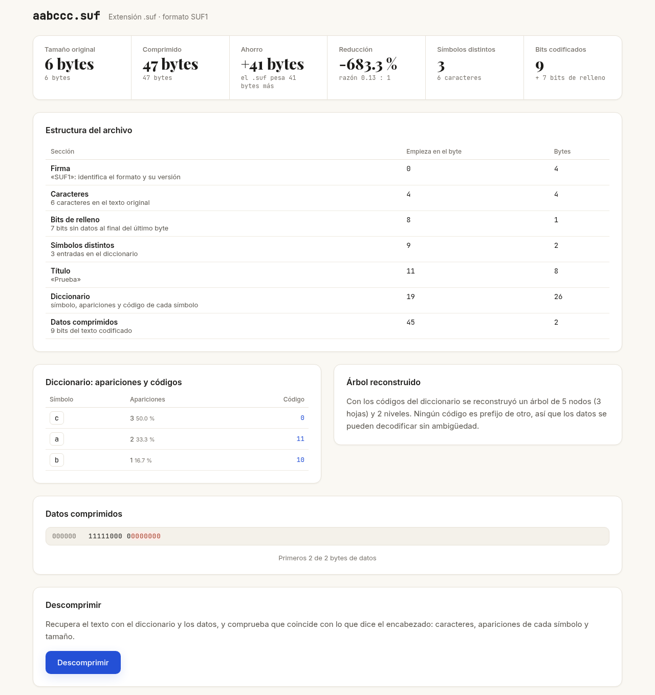
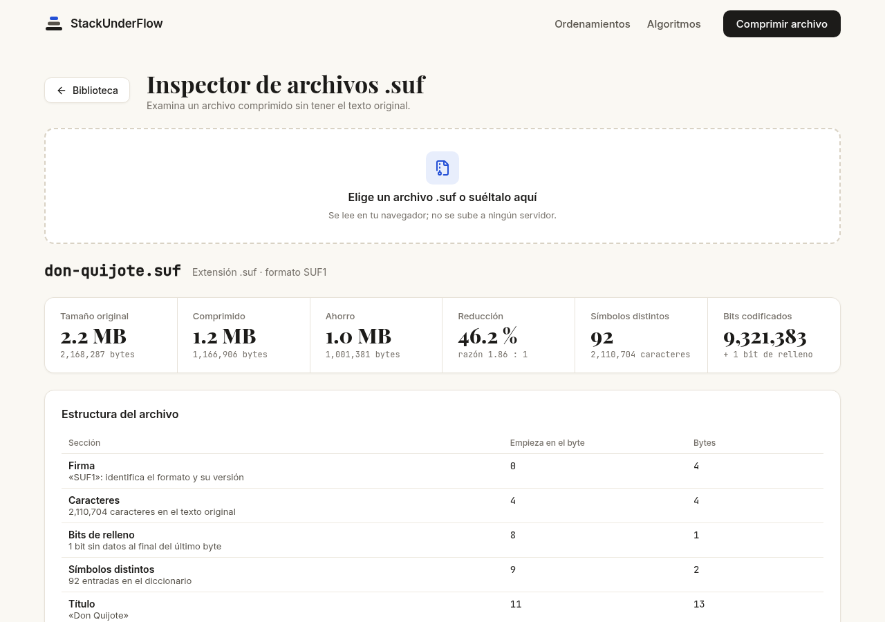
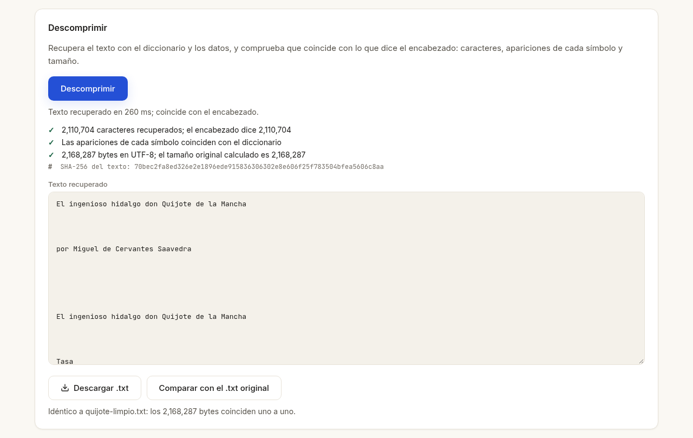
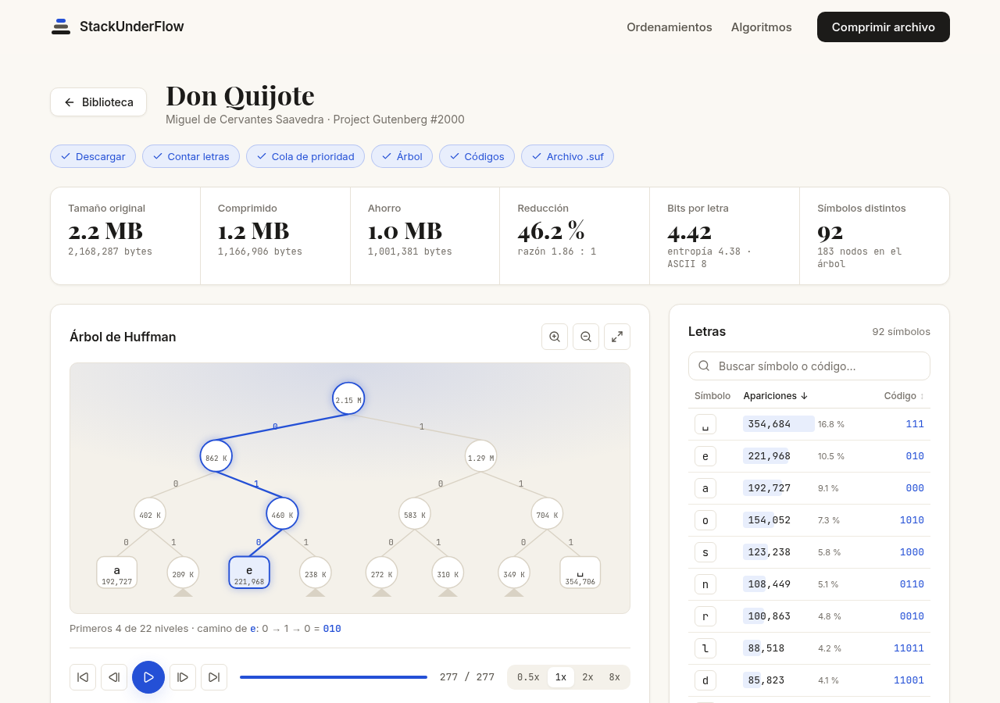
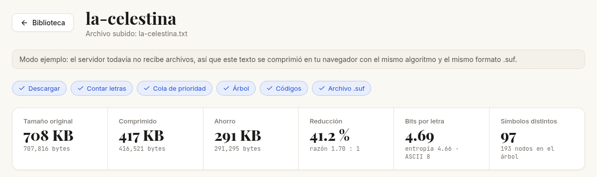
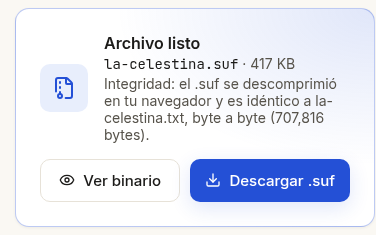
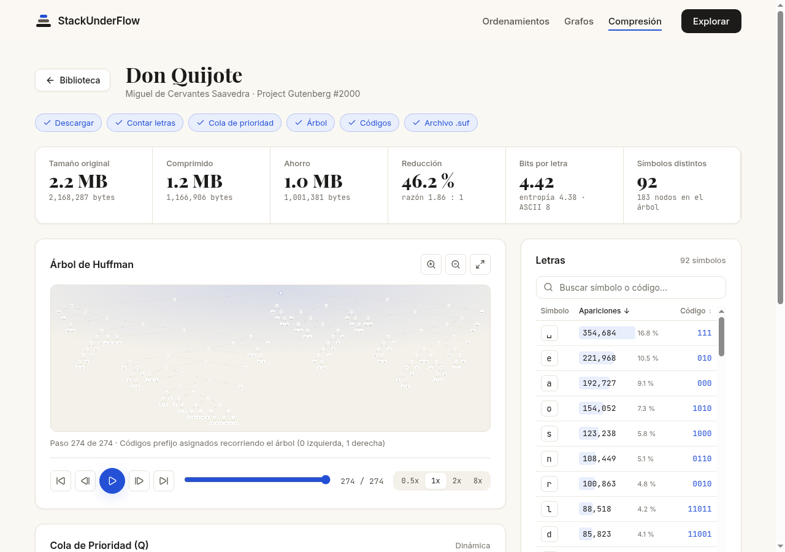
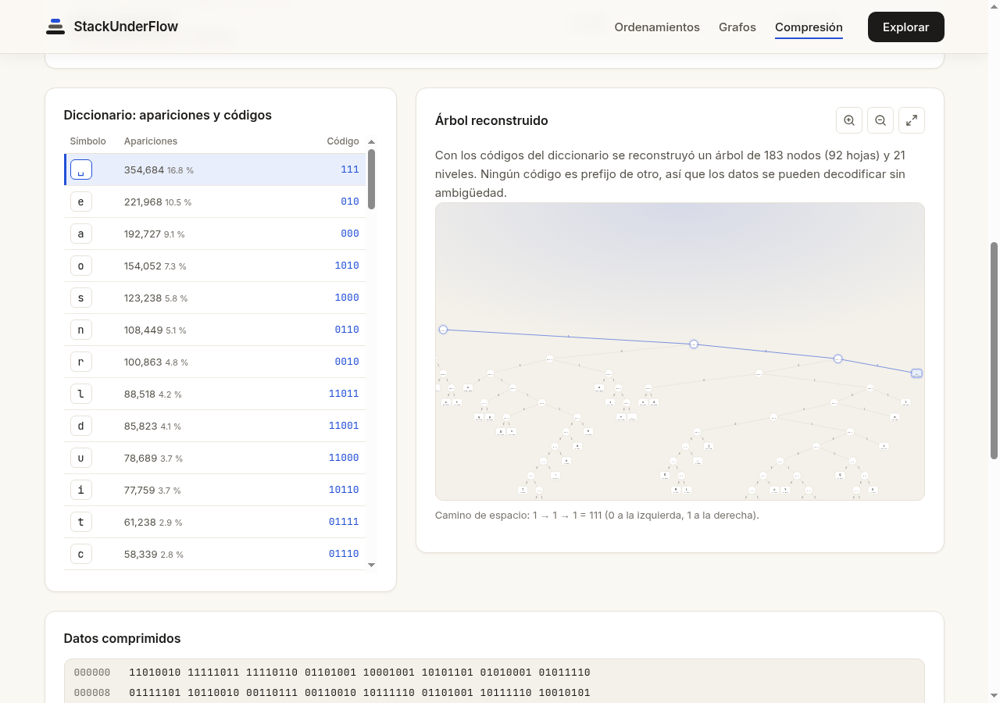
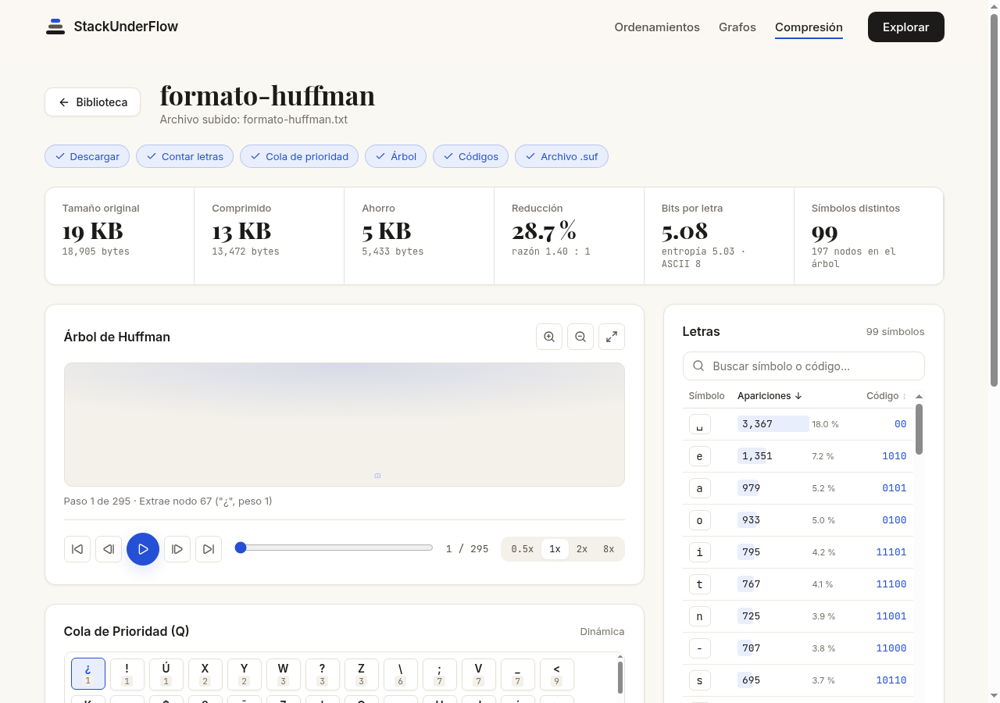

# Pruebas del compresor Huffman (frontend)

Evidencias de las pruebas mínimas de la sección 12 de los requerimientos y de la comprobación de integridad de la sección 8, en la parte que hace el frontend: leer un archivo `.suf`, inspeccionarlo, descomprimirlo y comprobar que el texto recuperado es idéntico al original.

> **Estado al 18 de noviembre de 2026.** El backend publicó `/huffman` en producción y la aplicación ya trabaja con sus rutas: catálogo, proceso, binario y subida. El [flujo completo en producción](#flujo-completo-en-producción) está al final de las pruebas.
> - **Pruebas 1 a 3:** los archivos `.suf` se generaron con un script de prueba que sigue el formato SUF1 de `docs/FORMATO-HUFFMAN.md` del backend. Los compresores del backend generan esos mismos archivos **byte a byte**, así que las cifras son las que da la aplicación.
> - **Prueba 4:** se hizo primero con la subida en modo ejemplo (compresión en el navegador) y después se repitió en producción con otro archivo: el backend y el navegador dan el mismo `.suf` byte a byte.

Todas las pruebas se hicieron en la aplicación publicada (https://stack-underflow-frontend-algviz.vercel.app/huffman.html#/inspector), con Chromium.

## 1. Texto pequeño: `aabccc`

Archivos: [`pruebas/aabccc.txt`](pruebas/aabccc.txt) (6 bytes) y [`pruebas/aabccc.suf`](pruebas/aabccc.suf) (47 bytes).

**Frecuencias.** `a` aparece 2 veces, `b` 1 y `c` 3. En orden de primera aparición, las hojas son `a` (id 0), `b` (id 1) y `c` (id 2).

**Construcción del árbol a mano.** La cola saca primero el menor peso y, si empatan, el menor id. El primero que sale va a la izquierda (bit 0) y el segundo a la derecha (bit 1).

| Paso | Cola antes (peso, id) | Sale `x` (izq., 0) | Sale `y` (der., 1) | Se inserta |
|---|---|---|---|---|
| 1 | b(1, 1) · a(2, 0) · c(3, 2) | b | a | nodo 3, peso 3 |
| 2 | c(3, 2) · nodo 3 (3, 3) | c (empate de peso: gana el id menor) | nodo 3 | raíz 4, peso 6 |

**Códigos.** `c` = `0`, `b` = `10`, `a` = `11`. El texto queda `11 11 10 0 0 0`: 9 bits en lugar de 48, que ocupan 2 bytes con 7 bits de relleno.

**Tamaño del archivo.** El encabezado mide 45 bytes:
- firma (4), caracteres (4), relleno (1), símbolos (2), largo del título (2) y título "Prueba" (6), que suman 19;
- más el diccionario: `a` y `b` miden 1 + 1 + 4 + 1 + 2 = 9 bytes cada uno, y `c` mide 8, que suman 26.

Con los 2 bytes de datos, el archivo mide **47 bytes**: más que el original, porque en un texto tan corto pesa más el diccionario que lo que se ahorra. El inspector lo dice ("el .suf pesa 41 bytes más").

**Resultado en el inspector.** Coincide con el cálculo a mano: 3 símbolos, códigos `c=0`, `a=11` y `b=10`, árbol de 5 nodos y 2 niveles, y una fila de datos `11111000 0` con los 7 bits de relleno marcados. Al descomprimir se recupera `aabccc`, y al compararlo con `aabccc.txt` sale idéntico: 6 de 6 bytes.

## 2. Libro de Project Gutenberg: Don Quijote (#2000)

Texto: `https://www.gutenberg.org/cache/epub/2000/pg2000.txt`, sin la licencia de Gutenberg (entre `*** START OF` y `*** END OF`), sin BOM y con `\n` en lugar de `\r\n`, como lo limpia el backend.

| Dato | Valor |
|---|---|
| Texto original | 2,168,287 bytes, 2,110,704 caracteres |
| Símbolos distintos | 92 |
| Archivo `.suf` | 1,166,906 bytes: encabezado 1,733 y datos 1,165,173 |
| Bits codificados | 9,321,383, más 1 bit de relleno |
| Ahorro | 1,001,381 bytes, **46.2 %** de reducción, razón 1.86 : 1 |
| Árbol reconstruido | 183 nodos (92 hojas) y 21 niveles |
| Descompresión en el navegador | entre 180 y 260 ms |

El inspector calcula el tamaño original solo con el diccionario (frecuencia × bytes de cada símbolo en UTF-8) y da 2,168,287 bytes, el tamaño exacto del texto. Los primeros 128 bytes de datos que muestra, decodificados con el diccionario, dicen "El ingenioso hidalgo don Quijote…".

## 3. Integridad

Al descomprimir, el inspector comprueba tres cosas **sin necesitar el original**:
1. **Caracteres:** cuántos se recuperaron, contra lo que dice el encabezado.
2. **Apariciones:** se vuelven a contar en el texto y se comparan con el diccionario.
3. **Tamaño:** los bytes del texto en UTF-8, contra el tamaño original calculado.

Además, la descompresión falla si un bit no lleva a ningún nodo o si los datos terminan a la mitad de un código. También se muestra el **SHA-256** del texto recuperado. Si se tiene el `.txt` original, se compara **byte a byte**.

| Caso | Resultado |
|---|---|
| `don-quijote.suf` | Las 3 comprobaciones bien. SHA-256 `70bec2fa8ed326e2e1896ede915836306302e8e606f25f783504bfea5606c8aa`, igual al calculado con `sha256sum` del texto original |
| Comparado con el texto original | "Idéntico: los 2,168,287 bytes coinciden uno a uno" |
| Comparado con el mismo texto con BOM y `\r\n` | Idéntico después de quitar el BOM y cambiar `\r\n` por `\n` |
| Comparado con `pg2000.txt` sin limpiar | Distinto desde el byte 0, porque incluye la licencia que el backend quita |
| `don-quijote.suf` con **un bit cambiado** en los datos | Se detecta: "8 símbolos no coinciden con el diccionario" y el tamaño difiere en 1 byte |
| `.suf` con dos códigos repetidos | No se puede inspeccionar: "El código de «b» es prefijo de otro código o está repetido" |
| Archivo que no es `.suf` | "No es un archivo .suf: empieza con «Esto» en lugar de «SUF1»" |
| Texto descargado (`don-quijote.txt`) | Idéntico al original en disco |

## Flujo completo con el compresor del backend

Se levantó en local el backend de la rama `alesspiz/feature/huffman-endpoints` (commit `1bb12e5`, que descarga el libro de Gutenberg en vivo) y se conectó el frontend con `VITE_API_URL=http://localhost:3001`. Así se recorre `pg2000.txt → don-quijote.suf → recuperado.txt` con la aplicación:

| Paso | Resultado |
|---|---|
| Biblioteca | Las 6 tarjetas salen de `GET /huffman/books` |
| Proceso de Don Quijote | Datos reales en 1.7 s: 2,168,287 → 1,166,906 bytes, 1,001,381 ahorrados (46.2 %), 92 símbolos, 183 nodos |
| Binario | Encabezado leído del `.suf` del backend: 1,733 bytes de encabezado, 1,165,173 de datos y 1 bit de relleno |
| Descargar `.suf` | `don-quijote.suf` de 1,166,906 bytes, igual a `metrics.fileSizeBytes` |
| Inspector con ese archivo | Las 3 comprobaciones bien. Texto recuperado en 181 ms con SHA-256 `70bec2fa…a5606c8aa`, **el mismo del texto limpio original**: el ciclo comprimir → descomprimir devuelve exactamente el texto |

## 4. Archivo no utilizado durante el desarrollo

Archivo: *La Celestina* de Fernando de Rojas (Gutenberg #1619), `pg1619.txt` tal como se descarga, con la licencia, el BOM y los `\r\n`: 707,816 bytes, SHA-256 `3229d2ad5fdb1442a94cf53c88c63d7514b035b9cf814519dd617ea73e6c5567`. No se había usado en ninguna prueba.

Se subió en la biblioteca, en la zona **Sube un archivo .txt**, con la aplicación en local (Chromium) y un backend que responde 404 a todo, igual que el publicado hoy. Como el backend todavía no tiene `POST /huffman/compress/file`, la aplicación lo comprimió en el navegador (modo ejemplo, `src/js/huffman/compresor.js`) y lo avisó en la vista.

| Dato | Valor |
|---|---|
| Original | 707,816 bytes, 97 símbolos distintos |
| Archivo `.suf` | 416,521 bytes |
| Ahorro | 291,295 bytes, **41.2 %** de reducción, razón 1.70 : 1 |
| Bits por letra | 4.69, con una entropía de 4.66 |
| Árbol | 193 nodos |
| Tiempo | 1.1 s desde que se elige el archivo hasta ver el resultado, con la comprobación incluida |
| Integridad | "el .suf se descomprimió en tu navegador y es idéntico a la-celestina.txt, byte a byte (707,816 bytes)" |

**Mismo resultado que el backend.** `compresor.js` es una copia del compresor del bloque A (rama `arcamp0130/feature/huffman-compressor`, `99a4e31`). Se compararon los dos con seis textos: `aabccc`, un solo símbolo, dos símbolos, emojis con BOM y `\r\n`, 200,000 caracteres con 84 símbolos de varios alfabetos y `pg2000.txt` completo. En los seis, el `.suf` es idéntico byte a byte y el `HuffmanResult` también (nodos, pasos, códigos, tabla y métricas, menos el tiempo de ejecución). Así, el resultado de la prueba 4 es el mismo que dará el backend cuando publique la ruta.

## Flujo completo en producción

El 18 de noviembre de 2026, con el backend publicado (`https://stack-underflow-backend-algviz.vercel.app`, rama `main` con backend#63 y #64) y la aplicación en Chromium. Gutenberg respondía `503` a Vercel, así que los libros salieron del respaldo completo del backend.

| Paso | Resultado |
|---|---|
| Biblioteca | Las 7 tarjetas salen de `GET /huffman/books`, incluido *Los pazos de Ulloa*, que solo existe en el backend |
| Proceso de Don Quijote | Sin el aviso de modo ejemplo: 2,168,287 → 1,166,906 bytes, 1,001,381 ahorrados (46.2 %, razón 1.86 : 1), 4.42 bits por letra con entropía 4.38, 92 símbolos, 183 nodos, 274 pasos |
| Proceso de Frankenstein (#84) | 83 símbolos, 247 pasos (3 × 83 − 2) y el árbol completo de 165 nodos |
| Binario | `don-quijote.suf` de 1,166,906 bytes, 9,321,383 bits de datos |
| Inspector con ese `.suf` | Texto recuperado en 180 ms: 2,110,704 caracteres y 2,168,287 bytes, las apariciones coinciden con el diccionario y el SHA-256 es `70bec2fa…a5606c8aa`, **el mismo del flujo en local del 9 de noviembre** |
| Árbol en el inspector | 183 nodos (92 hojas) y 21 niveles; al elegir un símbolo del diccionario se resalta su camino (el espacio: `1 → 1 → 1`) y se acerca a él |
| Libro fuera del catálogo (#1080) | `502`: la pantalla explica que Gutenberg no está disponible y ofrece reintentar |

### Prueba 4 en producción: archivo nuevo subido al backend

Archivo: `docs/FORMATO-HUFFMAN.md` del backend con extensión `.txt`, un texto técnico con tablas y código que no se había comprimido nunca: 18,905 bytes, SHA-256 `f04ede2d7459a3dfd000fa708bc835b7612c97f21f4f7e882393db3c58c53f01`.

| Dato | Valor |
|---|---|
| Ruta | `POST /huffman/compress/file` respondió 200; la vista no muestra el aviso de compresión en el navegador |
| Archivo `.suf` | 13,472 bytes: 5,433 ahorrados, **28.7 %**, razón 1.40 : 1 |
| Bits por letra | 5.08, con una entropía de 5.03 |
| Árbol | 99 símbolos, 197 nodos y 295 pasos |
| Integridad | "el .suf se descomprimió en tu navegador y es idéntico a formato-huffman.txt, byte a byte (18,905 bytes)" |

**Mismos bytes en el backend y en el navegador.** Se subieron tres archivos a `POST /huffman/compress/file?metadata=false` y se compararon con `src/js/huffman/compresor.js`: un texto con `ñ`, comillas y `\r\n` (576 bytes), `abracadabra alakazam zzzzzzzzzzzzzzz` (143 bytes) y `aaaa`, de un solo símbolo (25 bytes). Los tres `.suf` son idénticos byte a byte, así que el modo ejemplo da el mismo resultado que el backend.

### Pendiente

- **Búsqueda:** `GET /huffman/books/search` responde, pero devuelve los mismos 32 libros para cualquier consulta (también para `zzzzqq`): el parámetro no llega a filtrar en RapidAPI. Está reportado en backend#62.

## Cómo repetir las pruebas

1. Abrir https://stack-underflow-frontend-algviz.vercel.app/huffman.html#/inspector, o "Ábrelo en el inspector" desde la biblioteca.
2. Elegir o soltar un `.suf`, por ejemplo `docs/pruebas/aabccc.suf`.
3. Revisar las cifras, la estructura, el diccionario y los datos.
4. Pulsar **Descomprimir** y revisar las comprobaciones.
5. **Comparar con el .txt original** (`docs/pruebas/aabccc.txt`) para la comparación byte a byte.
